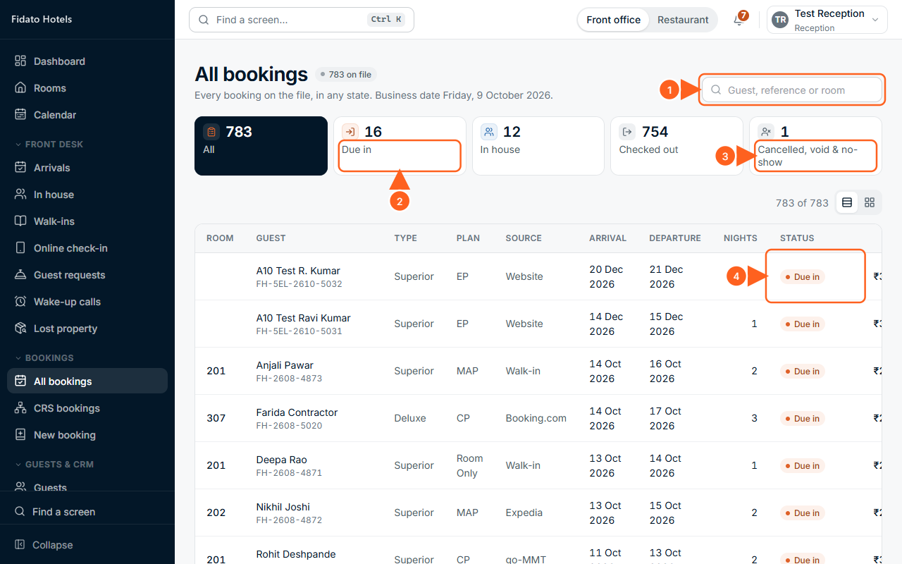

# Writing a chapter of the manual

For anyone - person or agent - writing or updating a chapter of the Fidato PMS
manual (D27-268, D27-293). Read `chapters/a8.html` first: it is the model.

## The rules

- **Truth first.** Describe the system as it is on branch `cp6`, from its code
  and its screens - never from memory or a plan. Open each screen before you
  describe it. Every button name, heading and message is copied exactly from
  the screen or the code, in the screen's words.
- **Quote a decision only if you found it** in `docs/briefs/decisions-*.md`
  (D17-…, D21-…, D22-…, D27-…) or a module's `MODULE.md`. Never invent a
  number. No decision for a rule? Explain it without one.
- **The demo hotel only**: 5 Elements Akkalkot (`5EL`), made-up guests. Never
  the live system. If you make test data (a booking, a guest), give it an
  obviously made-up name starting with your chapter, such as "A2 Test Kumar".
- **Change nothing in the app** - no code, no settings that matter beyond the
  demo. If you find something broken or a screen that does not match its
  description, write it in your report; do not fix it.
- **Never**: run the night audit, close a restaurant day, close a cashier
  shift for real, delete anything, change a price list or tax rate, switch a
  module off, push, deploy, or touch `api/.env`.
- Nothing leaves this machine: no publishing, no uploads.

## The shape of a chapter

One file, `docs/manual/chapters/<file>.html` (a2.html, b3.html …), containing
one `<section class="chapter" id="<file>">` exactly like A8:

```html
<!-- ══════════════════════════════ CHAPTER A2 ══════════════════════════════ -->
<section class="chapter" id="a2">
  <div class="chapter-head">
    <span class="num">Chapter A2</span>
    <h1>Bookings</h1>
    <p>Who it is for, and what it covers, in one or two sentences.</p>
  </div>

  <!-- A2.1 -->
  <h2 id="a2-1"><span class="n">A2.1</span>Title</h2>
  <p>…</p>
  <h3>To do the thing</h3>
  <ol class="steps"><li>…</li></ol>
  <figure class="shot" id="fig-A2-01">
    
    <figcaption><b>Figure A2-01.</b> One line.</figcaption>
    <ol class="callouts"><li>What arrow 1 points at</li><li>…</li></ol>
  </figure>
  <div class="box watch"><h4>Watch out</h4><ul><li>…</li></ul></div>
  <div class="box why"><h4>Why it works this way</h4><p>… <span class="d">D27-249</span> …</p></div>
</section>
```

- `<span class="ui">Button</span>` for the screen's exact words;
  `<span class="msg">“A message”</span>` for a message the system shows;
  `<code>/h/5EL/arrivals</code>` for an address.
- Sections numbered A2.1, A2.2 …; figures A2-01, A2-02 … (phone pictures:
  `<figure class="shot phone">`).
- Steps a person does are `<ol class="steps">`; the numbered list under a
  figure matches the picture's orange numbers exactly.
- Each part of the menu has ONE chapter that names every screen in it, even
  when another chapter has the detail ("Housekeeping - see A6"). The test
  `src/test/manual.test.ts` checks this for the sections in its `COVERS`.
- Plain English for hotel staff: short sentences, the task first, the why
  after. The owner's book (Part B) explains how and why for the owner.

## The pictures

1. Write `docs/manual/shots/<file>.mjs` (see `shots/a8.mjs`): each picture's
   `id` (the file `img/<id>.png`), `as` (a test sign-in label: Owner, General
   Manager, Reception, Admin, Hotel Manager, Revenue Manager, Housekeeping,
   Inventory Manager, Kitchen Manager, Chef, Accountant), `path`, `size`
   (`desk` 1280×800 default, `phone` 375×812, `wall` 1440×900), `steps`
   (`click`, `clickIf`, `type: [target, text]`, `waitFor`, `wait`, `scroll`,
   `eval`, `settle`, `offline: true|false` - this browser's own connection
   cut, for the offline bar), and `marks` (`{ n, at, side, nth }`). Targets:
   `text:Exact words`, `label:aria-label`, `css:selector`. `noShot: true` for
   a step with no picture.
2. Take them: `node docs/manual/tools/shoot.mjs <file>` (or with ids after
   it). **Set `CDP_PORT` to your own port** when others may be taking pictures
   at the same time: `CDP_PORT=9341 node docs/manual/tools/shoot.mjs a2`.
3. **Look at every picture** (open the PNG). An arrow on the wrong thing, a
   number on top of another, a loading screen, a "Start here" card in the
   way (`clickIf: "text:Got it"`), or a test-only "Development only" block in
   view all mean: fix the spec and take it again.
4. Needs the local web (5173) and API (8787) running - they are.

## When it is done

- `node docs/manual/tools/build.mjs` joins the chapters into `manual.html`.
  (When several people write at once, only the person merging builds.)
- `npx vitest run src/test/manual.test.ts` passes.
- Add the menu sections your chapter covers to `COVERS` in that test.
